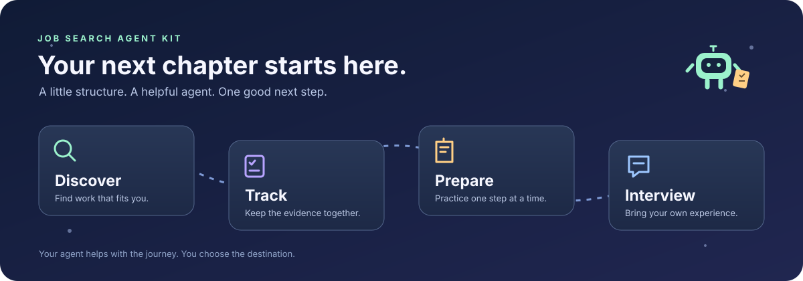

# Job Search Agent Kit



Set up an AI assistant that can discover suitable jobs, track applications, prepare truthful materials and coach interviews across sessions. Bring your own agent and choose local Markdown, Obsidian, Notion or another canonical store.

## Quick start

1. Install [Python](https://www.python.org/downloads/) 3.10+ and use an AI agent that can read and write local files. Download this repo using **Code → Download ZIP**, or clone it.
2. Create a separate private workspace:

   ```sh
   python3 scripts/init_workspace.py ../my-job-search
   ```

3. Open that new folder in your agent. Copy the setup prompt from [PROMPTS.md](PROMPTS.md), replacing `<workspace>` with the folder's absolute path. The agent asks for your goals, resume, constraints, storage and action boundaries, then records confirmed answers.
4. Optional: install [Obsidian](https://obsidian.md/download) and open the new folder as a vault. For Notion, connect an authorized integration if available and follow the [storage guide](docs/GUIDE.md). A connector is optional, never assumed installed.
5. Review a small verified shortlist before preparing applications. Start at the generated CONTEXT.md to resume in any new chat.

## What's included

| Component | Purpose |
| --- | --- |
| Four skills | Setup/review, job discovery, applications/tracking, interview preparation |
| Private workspace template | Preferences, candidate evidence, handoff and three tracking/coverage ledgers |
| On-demand note templates | Create a role, company brief, exercise or session only when needed |
| One fictional company example | Shows role research, preparation and evidence handling without real candidate data |
| Local infrastructure | Safe initializer, ledger validator, derived SQLite index, due-action report and privacy-pattern audit |
| Tests and CI | Protect identity matching, dates, note boundaries, safe initialization and database rebuilds |

The repo is deliberately moderate in size. Empty folders are generated by setup rather than stored as placeholder files. Small prompts and note templates are grouped. No employer-specific preparation banks are included.

Read [agent prompts](PROMPTS.md), the [operating/storage guide](docs/GUIDE.md), [data model](docs/architecture.md), or the [fictional preparation example](examples/company-preparation.md). Each portable skill lives under `skills/` and can be read explicitly by an agent without native skill support. Automatic skill installation is not assumed.

## Tracking tools

Run these from this repo, supplying your private workspace path:

```sh
python3 scripts/check_workspace.py ../my-job-search
python3 scripts/build_index.py ../my-job-search
python3 scripts/review.py ../my-job-search
```

Markdown is canonical. SQLite is an optional rebuilt index, not a second editing surface. The scripts run locally without third-party Python packages, a database server or model API keys. They do not browse, send messages, apply, schedule automation or connect accounts. Your agent performs authorized research using its own tools.

## Privacy and permissions

Keep CVs, contacts, employer correspondence, applications and practice answers in the separate private workspace. Its generated `.gitignore` excludes everything by default. This does not encrypt files or protect data already uploaded. An agent may send file excerpts to its model provider, so review its data controls.

The kit contains neutral instructions and one explicitly fictional example. It never copies the source project's private records or history. Discovery, materials preparation and submission are separate actions. Configure your own preferences and authorization boundaries during onboarding.

## Maintenance and next improvements

```sh
python3 -m unittest discover -s tests -v
python3 scripts/audit_release.py
```

The audit flags common private-data patterns in Git-tracked files. Review narratives and examples too. Contributors should use fictional data and preserve the dependency-free local workflow.

Possible extensions include official-board change detection, read-only receipt reconciliation, calendar preparation briefs, adaptive practice and a Notion adapter. These are [roadmap ideas](docs/GUIDE.md), not installed integrations or autonomous actions.
