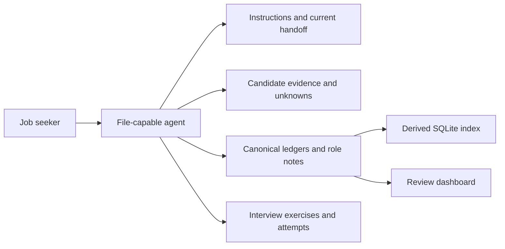

# Architecture and data model

The durable workspace is the memory shared across chats. An agent reads only the records needed for the current task and writes confirmed changes back during the session.

## Sources of truth

| Record | Owns |
| --- | --- |
| INSTRUCTIONS.md | User decisions, constraints, action authorization, canonical storage |
| CONTEXT.md | Current handoff: task, artifacts, questions, next actions |
| profile/CANDIDATE.md | User-confirmed facts, CV claims, resume source and open questions |
| Job Tracker.md | One row per exact opportunity, current process state |
| jobs/JNNN.md (created on demand) | Full posting evidence, fit assessment, aliases, dated process events |
| jobs/Company Search Queue.md | Discovery candidates, search coverage, recheck triggers |
| Search Log.md | What was checked, sources, limits, failures, date |
| interviews/Question Tracker.md | Attempt status, score, help received, review date |
| interviews/exercises/QNNN.md (created on demand) | Immutable scenario/version contract and attempt references |

A company lead is not a verified opportunity. Recruiter discussion is not submission. An application submission is not an employer acknowledgment. A prepared exercise is not an attempt. A coaching suggestion is not career evidence.

## Role identity and state

Use stable `J001` IDs. Match employer aliases, role title, board and requisition IDs, canonical posting URL and historical URL aliases before creating a row. Different requisitions may be distinct, even with identical titles. A generic recruiter lead can have an unresolved exact role, explicitly labeled in its note. Do not guess the match.

The tracker has separate axes:

- **decision**: review, pursue, deferred, declined
- **stage**: discovered, verified, materials-ready, submission-reported, acknowledged, interviewing, offer, rejected, withdrawn, closed
- **route**: direct, recruiter, referral, unknown
- **ownership**: clear, unresolved, recruiter-managed, referral-pending

A role can be interviewing while its posting closes. Record posting availability in the role note without erasing process history. Use `submission-reported` for a user-confirmed submission without acknowledgment. Record the evidence, never advance from expectation alone. Do not force uncertain or out-of-order evidence into a guessed chronology.

Dates use ISO `YYYY-MM-DD`. Leave an unknown event date blank and retain the report date. Relative deadlines need a timezone and an explicit interpretation. Every material event records event date, report date, source, interpretation, and uncertainty. Preserve prior events and submitted material versions.

## SQLite

`build_index.py` validates and imports both ledgers into `roles` and `practice` tables, plus a `metadata` table. There is a unique nonempty `(employer, board, requisition)` key. Full sources, URL aliases, evidence events and company coverage remain in Markdown. The database is a convenience index, not an alternative editing surface or full event store. It is rebuilt atomically from validated files. No bidirectional sync is provided.
